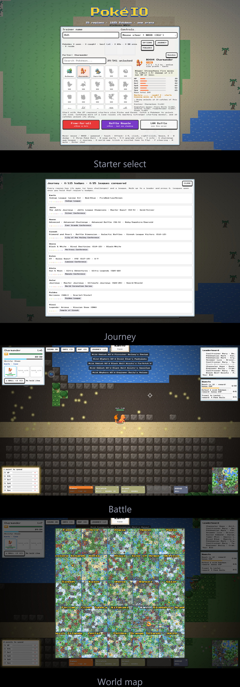

# PokéIO

A slither.io-style Pokémon battle game in the browser. It includes every Pokémon form (megas, Gigantamax and regional forms) and every move. Sprites use the FireRed/LeafGreen style.

This is a private, non-commercial fan project. The sprites and data come from PokeAPI and belong to Nintendo, Game Freak and The Pokémon Company.

---

## 📸 Screenshots

<a href="docs/screenshots/showcase.jpg"></a>

---

## Setup

```
npm install
npm run fetch   # downloads data + sprites from PokeAPI (one time, a few minutes)
npm start
```

Open `http://localhost:3000`.

## LAN battle

Run `npm start` on one PC. The server prints a `LAN:` address. Other players on the same Wi-Fi open that address and pick **LAN Battle**.

If Windows Firewall asks, allow Node.js on private networks.

Bots fill empty slots, and the server holds up to 30 players. Environment variables:
- `MODE=br npm start` runs Battle Royale instead of free-for-all.
- `BOTS=0 npm start` turns bots off.
- `PORT` changes the port.

## Controls

| Action | Key |
| --- | --- |
| Move | Your Pokémon steers toward the mouse in any direction. WASD/arrows override. `F` toggles mouse steering. |
| Aim | Mouse. The foe nearest your cursor is soft-locked (red ring) and gets every attack. |
| Moves | `1`-`4`, left click (move 1), right click (move 2), Space (move 3), `E` (move 4) |
| Gamepad | Left stick moves, right stick aims, A/B/X/Y fire moves 1-4 |
| Dodge roll | `Q` (gamepad RB, or the DODGE button). Brief invulnerability. |
| Stat upgrades | `5`-`0` = HP/Atk/Def/SpA/SpD/Spe, or click the panel |
| Throw Poké Ball | `C` (gamepad LB) |
| Swap party Pokémon | `R`, or click a party slot |
| World map | `O` |
| Info | `I` or Tab shows stats, ability, size and evolutions |
| Learn a new move | `Shift+1-4` to replace a move, `X` to skip |
| Mute | `M` |
| Chat (LAN) | `Enter` |

On phones, drag anywhere to move and tap the move buttons. Aiming is automatic.

## Mechanics

- **Sizes** come from each Pokémon's real height (compressed so giants stay playable). Weight sets how far hits knock you back.
- **Abilities**: each Pokémon gets its real ability, 192 abilities have game effects, covering 94% of forms (Blaze, Levitate, Static, Intimidate, Huge Power, Drought...).
- **Move types**: every move plays as one of these archetypes:
  - Melee: claw, punch, bite, kick, horn or tackle
  - Shot or volley
  - Beam
  - Sky strike
  - Hazard zone
  - Burst or quake
  - Shield
  - Weather aura
  - Self-buff
- **Stats**:
  - Every level gives 1 upgrade point (15 ranks per stat, +4% each).
  - Each spawn rolls random IVs and one of the 25 natures.
  - Growth rate matters: Fast growers level quicker than Slow ones from the same orbs.
- **Body**:
  - Light Pokémon accelerate and turn faster and recharge their dodge sooner.
  - Heavy Pokémon resist knockback and hit harder with contact moves.
  - Tiny Pokémon evade up to 15% of aimed attacks.
- **Cooldowns** scale with power and PP: Tackle is about 1 s, Hyper Beam about 3.5 s.
- **Spawns**: bots and wild Pokémon start from stage-1 species. They match a human's level (±3) and evolution stage, and 1 in 25 is one stage up or down, never more.
- **Fairness**: a single hit deals at most 35% of max HP. You get 3 s of spawn protection, and bots ignore much weaker trainers unless provoked.

## World and progression

- **World:** a new random world every game, Minecraft-style.
  - 6000×6000 tiles (192,000 px across), generated in 64×64 chunks as you explore.
  - 25 regions on a shuffled 5×5 grid, linked by bridges over sea channels.
  - Each region has its real towns plus about 22 procedural villages, connected by roads.
  - Orbs, wild Pokémon and bots spawn around players and recycle when far away.
  - Fly: click any town you have visited on the world map (`O`).
  - The main series: Kanto, Johto, Hoenn, Sinnoh, Unova, Kalos, Alola, Galar and Paldea.
  - Side games and DLC: Hisui, Orange Islands, Sevii Islands, Orre, Fiore, Almia, Oblivia, Ransei, Isle of Armor, Crown Tundra, Kitakami, Blueberry Academy, Pasio, Lental, Ferrum and Decolore Islands.
  - Each region has its own mix of biomes: route, forest, hills, city, beach, islands, volcano, snowfield with slippery ice, marsh, cave and haunted grounds.
  - Towns have Pokémon Centers that heal your party.
  - Wild Pokémon are natives of their region and biome, including regional forms in Alola, Galar and Paldea. Legendary raid bosses reward everyone who fought them.
- **Foraging:** running through grass, surfing, or bumping into trees can drop berries and Rare Candy, or ambush you with a low-level wild Pokémon.
- **Catching:**
  - Throw balls at wild Pokémon, or at other trainers' Pokémon (you get a copy; they keep theirs). The target needs at least 5% HP.
  - Your party of 3 trails behind you and fires support shots. Swapping is instant, and a teammate steps in when your active Pokémon faints.
- **Profile:**
  - You start with 29 starters. Catching a Pokémon unlocks its line.
  - More catches of a line raise its mastery, which means stronger starting moves. 10 catches unlock its shiny.
  - The Pokédex tracks species seen and caught, by region.
- **Modes:**
  - Free-for-all.
  - Battle Royale: a shrinking zone, no respawns, spectate after death, and automatic new rounds.
- **Combat extras:**
  - Combos: wet + Electric, wet + Ice freezes, exploiting a disabled target, and chain hits.
  - Kill streaks give an EXP bonus and put a bounty on you.
  - Held items: 14 to find on the map.

## Leagues

- **Gyms:** every region has its real gym leaders, or its boss challenges for side regions: Orange League, Orre colosseums, Hisui Nobles, Ransei warlords and so on.
  - Walk up to a leader and press `G`. The battle is real time against their type-themed team of 3, scaled to your level and ending with their ace. Other players can crash the fight.
- **Leagues:** each region's league (Elite Four, then the Champion, fought back to back) opens once you hold that region's badges.
- **Journey screen (`J`):** every region's anime arc or game, its badges and its league titles.

## Atmosphere and extras

- **Day/night:** a 6-minute day. Nights are dark with light around Pokémon and towns, Ghost and Dark moves get 1.2x, and more Ghost and Dark types spawn.
- **Regional weather:** rain, harsh sun, sandstorm, snow and fog. Each changes per region every 1-2.5 minutes, boosts matching types, and has on-screen effects.
- **Cries:** real Pokémon cries (`npm run fetch` downloads them) on spawn, swap, evolution and catch.
- **Quests:** 3 rotating objectives that pay out Poké Balls, Rare Candy, held items or EXP.
- **Area signs:** FireRed-style popups for each region, town and biome.
- **Title screen:** a live world with bots fighting behind the menu.
- **Pause and options:** `Esc` pauses offline play. You can set music and SFX volume, particle quality, screen shake and name tags.
- **Death screen:** a summary of the run.

## Tests

```
npm test
```
